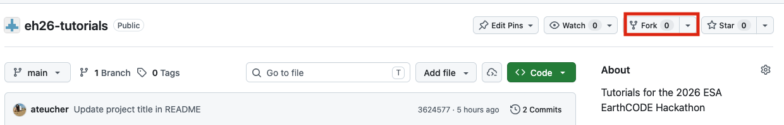
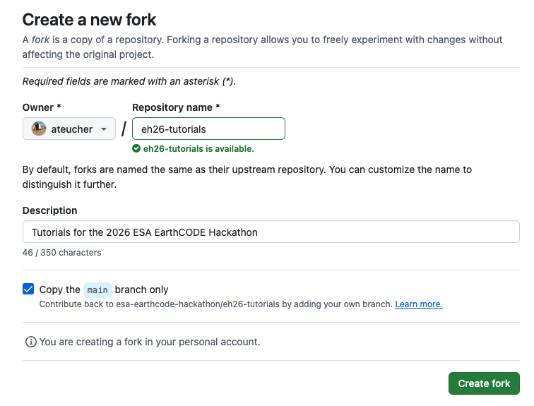
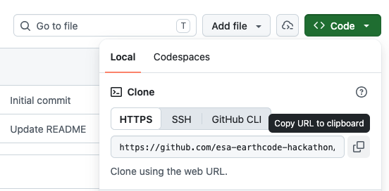
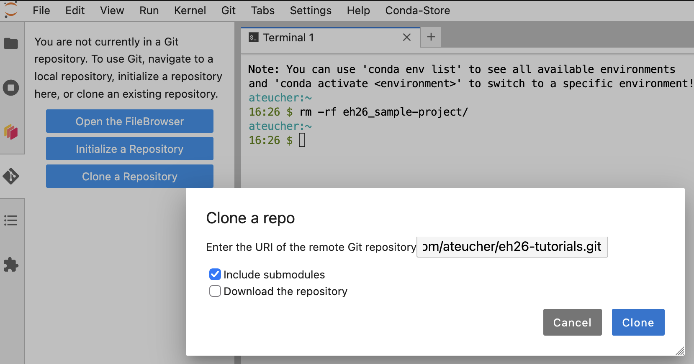
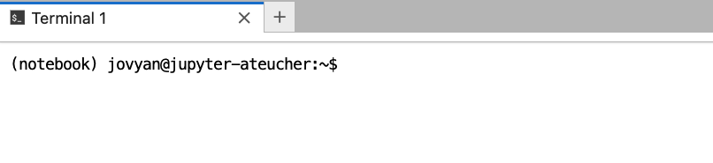

[Git](https://git-scm.com/) is a popular version control system that is the foundation of most open source software development. You are not required to be a Git pro in advance of this event, but come prepared to learn about it and practice! [GitHub](https://github.com) is a hosting service for Git repositories, enabling us to share code across teams in a web environment.

We will use Git and GitHub for collaborative work. Be sure to arrive at the Hackathon with your own [GitHub](https://github.com) account.

You will be added to the [ESA EarthCODE Hackathon](https://github.com/esa-earthcode-hackathon) GitHub organization with your GitHub username. This will give you access to the repositories relevant to the hackathon, and allow you to create a repository for your project in which you can collaborate with your team.

Your GitHub username is also what you will use to [log in to the JupyterHubs](jupyterhubs.qmd#accessing-the-jupyterhubs) during the hackathon.

## Step 1. Fork the Hackathon Tutorials GitHub repository

"How do I get the tutorial repository into the Hub?". There are 2 steps. The first is from GitHub.com to *fork* the tutorial repository so that there is a connected copy in *your user account* that you can edit and push changes that won't affect the esa-earthcode-hackathon copy.

Go to <https://github.com/esa-earthcode-hackathon/eh26-tutorials> and fork the repository.





## Step 2. Clone the Hackathon Tutorials GitHub repository

Now we'll *clone* the GitHub repository into our home directory in the JupyterHub, using a git extension. Go to your github account, and navigate to the repository that you just created by forking from the esa-earthcode-hackathon repository.

Click to copy the url for cloning the repository.



Now, go to JupyterHub and click on the git extension in the left panel and then click the blue button "Clone a Repository".


Then, paste the repository link of the forked repository that you copied from your github account into the "Clone a repo" pop up window. Then click the blue "CLONE" button. It will take a few moments to clone the repository into your Hub.

Your link should look like `https://github.com/YOUR-USERNAME/eh26-tutorials`. For example, the link is https://github.com/**ateucher**/eh26-tutorials. Note that it includes your github username in the repo link.



Alternatively, you can use the terminal (command line). Navigate to the "File" menu, choose "New" and then "Terminal" or click on the "terminal" button in the JupyterLab Launcher:


This will open a new terminal tab in your JupyterLab interface:



In the terminal type:

```bash
git clone https://github.com/YOUR_USERNAME/eh26-tutorials.git
```

Once the repository is cloned, you will see a new directory in the "File Browser" panel on the left named "eh26-tutorials". In this directory, you have all hackathon material including the tutorials and this book to follow along during other Tutorials. You are all set.


## Step 5. Tracking changes

Now that you have forked and cloned the repository in your Hub, you can make changes (edit, add, and/or delete content) and track these files using git. In this step, we will provide an overview of how to use git using the graphical interface (the JupyterLab git extension).

### Step 5.1. Create a new file

Let's create a new file: In the left panel on your Hub, click on the "directory" icon and then double click on "2021-Cloud-Hackathon" directory. Then, create a new file using the text editor in your 2i2c JupyterHub (`File >> New >> Text File`). Add some text to this file, for example: `A test file`. Save this file and rename it to `test.txt`.


### Step 5.1. Configure Git (`git config`)

In the Terminal, configure git with your name and email address as shown here.

``` bash
git config --global user.name "Andy Teucher"
git config --global user.email "andy.tuecher@gmail.com"
```
### Step 5.3. Track the changes to the new file (`git add`)

Click the git icon in the left panel. You can see that the newly added file is in the "Untracked" section. You can click the `+` icon next to the file name to let `git` track this file for changes.


### Step 5.4. Commit the changes to the new file (`git commit`)

Now, you will see that the file is **Staged**, which means that `git` is ready to take a snapshot of this file (and the repository) with the changes that you made. This snapshot is called a `commit`. To commit the changes, add a note (called a *commit message*) by typing in the text box that say "Summary".

Now, click the blue "COMMIT" button to commit this change.

> Note: A short message indicating the type of change to this file is a good practice. Optionally, a longer description may be added to the "Description" field.


### Step 5.5. Transmit committed changes to your github (`git push`) {#step-5.5.-transmit-committed-changes-to-your-github-git-push}

At this stage, you have committed the changes to your git repository on your Hub. However, these changes are still on your Hub and needs to be transmitted to your repository on github (so that both the `local` copy on the JupyterHub and the `remote` copy on github are in sync).


As seen in the picture below, the git extension indicates (with an orange dot on the cloud icon) that it is ready to `push` your changes to the `remote` (remote = your repository on github.com).

We need to give Git some information so that we can authenticate with GitHub to allow us to push our changes to our GitHub repository. We will do this using a "Personal Access Token" from GitHub.

First, configure `git` to store your github credentials to avoid having to enter your github username and token each time you push changes to your repository.

``` bash
git config --global credential.helper store
```

To push to github, click the cloud button with an up arrow (circled in red in the picture).


When you push for the first time, it will ask that you input your credentials. You will need to set this up with your Personal Access Token (PAT), explained next. 

### Step 5.6. Setup your Personal Access Token (PAT) {#step-5.6.-setup-pat}

When you see the following screenshot, GitHub is asking for you to input your credentials. (Note: you see this screenshot when you have committed work to push to GitHub.com, as detailed above).


The git extension in the Hub is prompting you to enter your github.com credentials. Enter you github.com username and a Personal Access Token (PAT);  **DO NOT** use your password. 

To create a PAT, visit **<https://github.com/settings/tokens/new>** and create a new token with the permission as per the image below and specify its validity for 90 days.


**IMPORTANT:** You will see this token only once, so be sure to copy this. If you do not copy your token at this stage, you will need to generate a new token.


Once you generate the token, copy it and paste in the Hub window that prompted you to enter the "Personal Access Token".


Git will show a message at the bottom right telling that the changes were "Successfully pushed". Also, you will see that the "cloud icon with an up arrow" no longer has an orange dot, indicating that there are no more committed changes to push to the remote (github.com).

> Note: You have configured git extension to store your credentials. You will not be prompted for your login/token again!


That's all. You can use the same workflow (`add > commit > push`) for any other new or modified files!

## Collaborating on Projects
