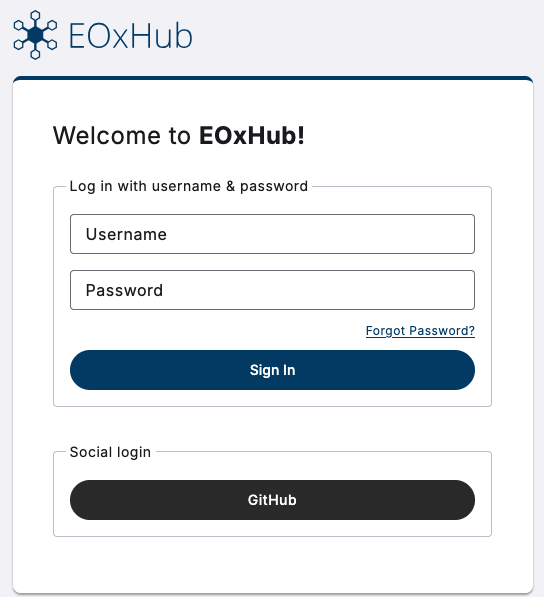
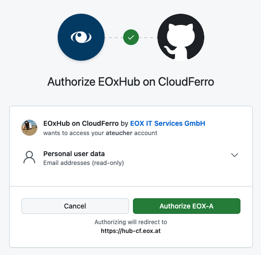
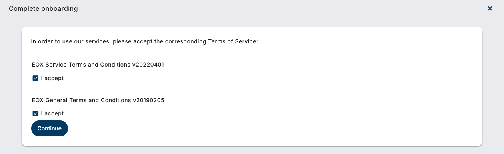
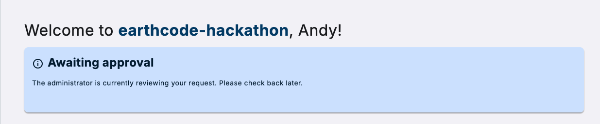
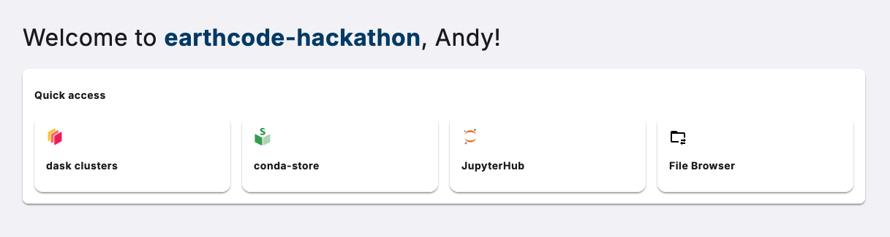
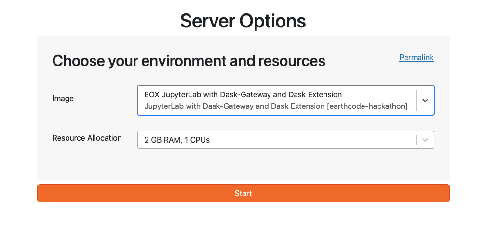
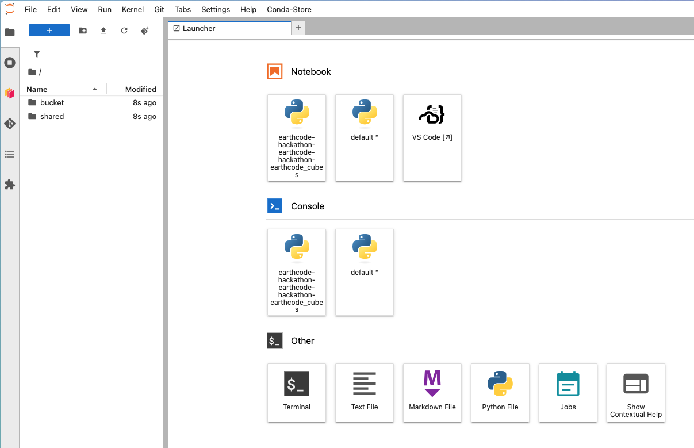
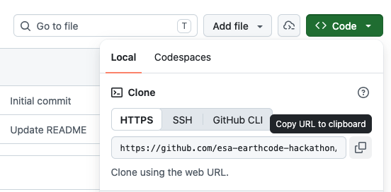
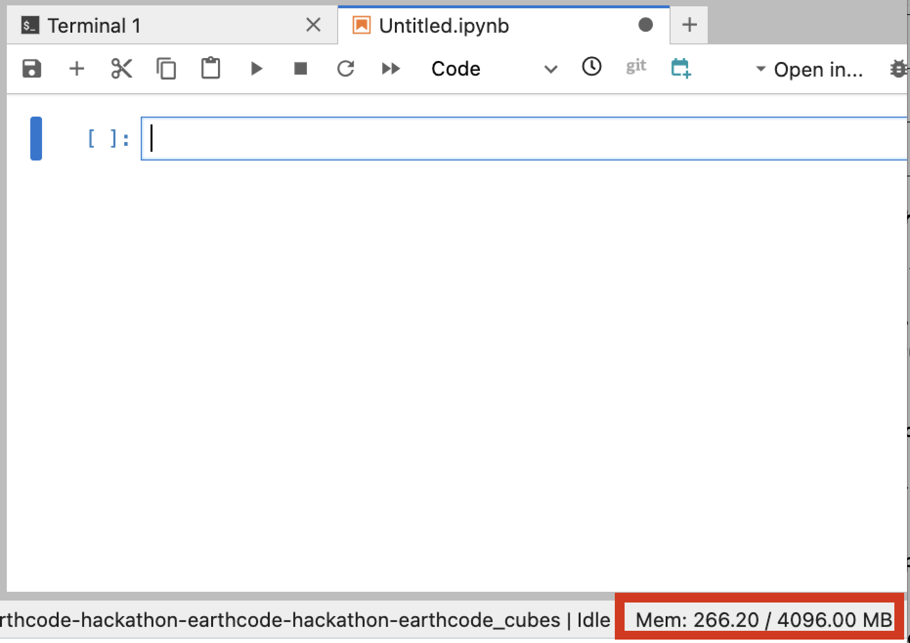
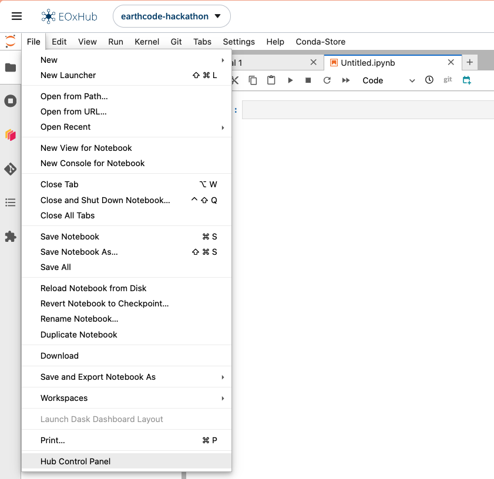

During the Hackathon, all participants will have access to a JupyterHub-based shared cloud computing environment through the EarthCODE platform.

## Why are we using a shared cloud computing environment?

Teaching software to a diverse group of participants, each with different computers and operating systems, can be challenging. There are specific ways to configure our software for the tutorials to be successful, so it takes time to get everyone set up consistently. Our solution to this is to give everyone access to a cloud computing environment that is pre-configured for the specific software we will deploy. This cloud computing instance can be accessed from any web browser, which eliminates the need for configuring each person's individual computer. We use JupyterHub as a way to give a Jupyter Notebook server ([JupyterLab](https://jupyterlab.readthedocs.io/en/stable/)) to each person in a group. JupyterHub enables us to quickly begin working with code without spending time to get the necessary libraries and dependencies set up on everyone's individual computers.

## Compute platforms available during the Hackathon

We will be providing access to two different JupyterHubs available through EarthCODE. These are very similar in functionality, but each one is optimized for cloud data access for different data sources.

1. **[EOx Hub](https://workspace.earthcode-hackathon.hub-cf.eox.at/)** This JupyterHub is ideal for working with ocean and polar data. It is hosted on the same cloud infrastructure as the EarthCODE data (CloudFerro object storage), providing fast streaming access to these datasets.
2. **Earth Systems Data Lab ([DeepESDL](https://workspace.deepesdl-earthcode-hackathon-2026.deepesdl-v2.eox.at/hub))** This Hub is optimized for accessing carbon-related datasets using [EO-LINCS](https://www.eo-lincs.org/).

We encourage you to use these platforms for running the tutorials and for your projects. You can use either of the hubs available, but we recommend choosing the one that best matches the data you will be working with. We also hope you will practice installing Python libraries locally on your laptop so that you can continue working after leaving the event.

### Pangeo Tools

[Pangeo](https://pangeo.io/) is a community-driven ecosystem for scalable analysis of Earth and environmental data. The JupyterHubs provide an environment where you can use several tools commonly found in Pangeo environments:

- **Xarray** for labelled multidimensional arrays.
- **STAC** for consistent discovery and description of geospatial collections.
- **Dask** for lazy, parallel, and distributed computation.
- **Zarr** for chunked, cloud-optimised array storage.
- **Jupyter** for interactive and shareable workflows.

Together, these tools support workflows that begin with collection discovery, read only the required data, scale when necessary, and remain reproducible.

## Accessing the JupyterHubs

You will log in to the JupyterHubs using your GitHub account. Click the "GitHub" login button. 



If you're not currently logged in to GitHub, you will be prompted to do so. You will then need to authorize the JupyterHub application to access your GitHub account. 



Accept the EOx Terms and Conditions.


You will see a screen telling you your access is awaiting approval.



An admin will then approve your GitHub user account to allow access to the JupyterHub.

Once you are approved, you can log in to the platform and you will see various links and options. Click on the "JupyterHub" link, and then "Start My Server".



## Starting up

- **Environment** — choose the appropriate environment for the tutorials and project work. There will typically be multiple environments available, each pre-configured with different sets of tools and libraries.
- **Resource Allocation** — Pick the smallest allocation that does the job; the compute is shared and donated (see below for more [tips on resource management](#tips-for-managing-server-resources)).

You make this choice on every startup, so you can come back and pick something different later.



Then click **Start**. You will see a progress bar and an event log while your server spins up. 

::: {.callout-note}
## Startup can take several minutes

Starting a new node and pulling our environment takes a while — especially if everyone is logging in at once, such as at the beginning of a tutorial. Be patient, and don't reload repeatedly.
:::

Once things are spun up, you will be dropped into your very own cloud instance of the [JupyterLab](https://jupyterlab.readthedocs.io/en/stable/) interface. Here you will see the "Launcher" tab, which provides quick access to opening notebooks, a terminal, and other file types.



## How do I get the tutorial repositories?

For the tutorials, there are two primary ways of getting the notebooks. You can use the traditional git management route ([described below](#how-do-i-get-my-code-in-and-out-of-jupyterhub)), or you can use the magical nbgitpuller links below:

- [Placeholder for Tutorial 1](nbgitpuller-link-for-tutorial-1)
- [Placeholder for Tutorial 2](nbgitpuller-link-for-tutorial-2)
- ...

Nbgitpuller is nice, because it will automatically merge any changes you make with the changes from the upstream repo on subsequent pulls (i.e., when you click the links above again) via a [series of sane rules](https://jupyterhub.github.io/nbgitpuller/topic/automatic-merging.html#topic-automatic-merging).

## How do I get my code in and out of the JupyterHub?

When you start your own instance of JupyterHub you will have access to your own virtual drive space. No other JupyterHub users will be able to see or access your data files. Next we will explain how you can upload files to your virtual drive space and how to save files from JupyterHub back to another location, such as GitHub or your own local laptop drive.

First we'll show you how to pull some files from GitHub into your virtual drive space.

To do this, we will need to interface with the JupyterHub file system. JupyterHub is deployed in a Linux operating system and we will need to open a terminal within the JupyterHub JupyterLab interface to manage our files. There are two ways to do this: (1) Navigate to the "File" menu, choose "New" and then "Terminal" or (2) click on the "terminal" button in JupyterLab:


This will open a new terminal tab in your JupyterLab interface:


You can issue any Linux commands to manage your local file system.

Now let's clone a repository (see the [Git Setup and Basics](git-github.qmd) page). We'll illustrate this with the [placeholder] repository. First, navigate in a browser on your own computer to the repository link (TBD). Next, click on the green "Code" button and then copy the url into your clipboard by clicking the copy button (clipboard icon):



Now navigate back to your terminal in JupyterLab. Type `git clone` and then paste in the url:

```bash
git clone [url]
```

This will create a new directory in your current working directory with the same name as the repository (in this case, `[placeholder]`), and download all the files from the repository into it. You can navigate into this directory using the `cd` command:

```bash
cd [placeholder]
```

To be able to push changes back to the repository, you will need to configure your Git credentials and have the necessary permissions for the repository. See the [Git Setup and Basics](git-github.qmd) page for instructions on setting up your Git credentials.

## Tips for managing server resources

### Choosing the compute resources you need:

When you start your server, you choose a server size (for example, "~4 GB RAM, ~0.5 CPUs").
Choosing a server that is larger than you need wastes compute resources and reduces availability for others.

- **Start small.** The smallest server is enough for a lot of work, including writing code, and exploring data.
  If you run out of memory, choose a larger instance - you will need to shut down your server (File > Hub Control Panel > Stop My Server) and launch a new one by choosing an option with more resources in the dropdown menu.
- **Watch your memory use.** The memory indicator at the bottom of JupyterLab shows how much memory you are using.
  If you are consistently using under half of your server's memory, try choosing a smaller size.
  {fig-alt="JupyterLab memory usage indicator showing 287 MB of 2 GB used."}
- If your session restarts or crashes unexpectedly while loading or processing data, you have probably run out of memory.
  Try the next size up.
- **Use large servers only when you need them.** If you have a short, memory intensive task, start a large server for that task, then shut it down and go back to a smaller one for the rest of your work.
- **Shut down your server when you are done.**
  Use **File > Hub Control Panel > Stop My Server** rather than just closing your browser tab.
  Servers are shut down automatically after a period of inactivity, but stopping them yourself is a good idea.
- **Work in chunks.** Processing data in smaller pieces (for example, by time step or region) or loading data lazily (e.g., with `xarray` and `dask`) often lets you use a much smaller server.

### End your Hub session every day.

**When you are finished working for the day or for an extended period of time, it is important to explicitly shutdown your JupyterHub session**, to reduce the load on our cloud infrastructure and overall costs.

**To shutdown your server:**

If you are **using JupyterLab**, you access the control via `File > Hub Control Panel` menu item:



Then click **Stop My Server** in your hub control panel (which you can also reach directly at [https://hub.eoxhub.com/hub/home](https://hub.eoxhub.com/hub/home)):


Note that the menu item `File > Log Out` doesn't actually shut down the server, so please follow these steps instead.

::: {.callout-note}
**You will not lose your work when shutting down the server.** Shutting down (`Stop My Server`) will **NOT**
cause any of your work to be lost or deleted. It simply shuts down some resources.
It would be equivalent to turning off your desktop computer at the end of the day.
:::
